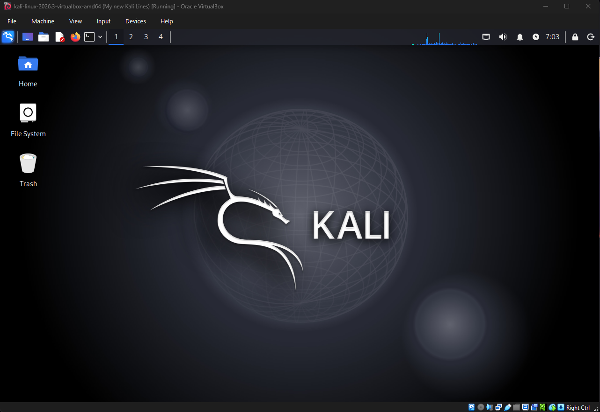
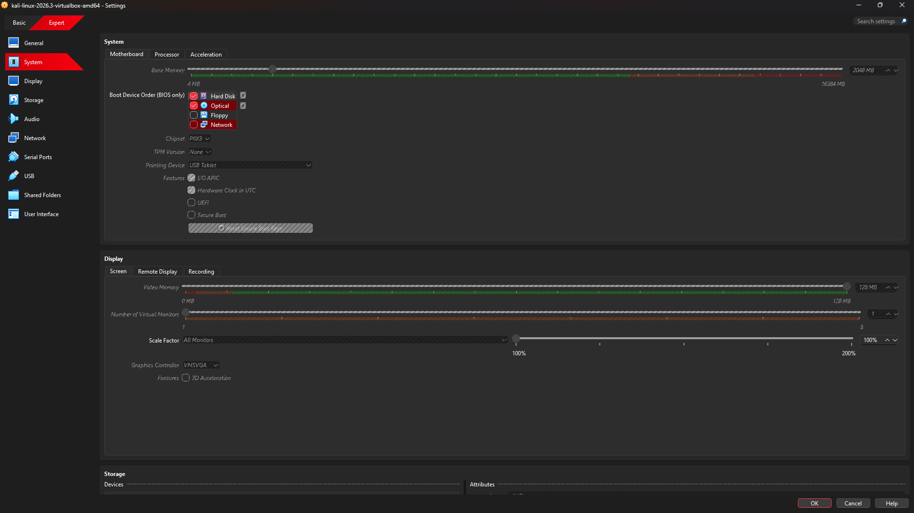
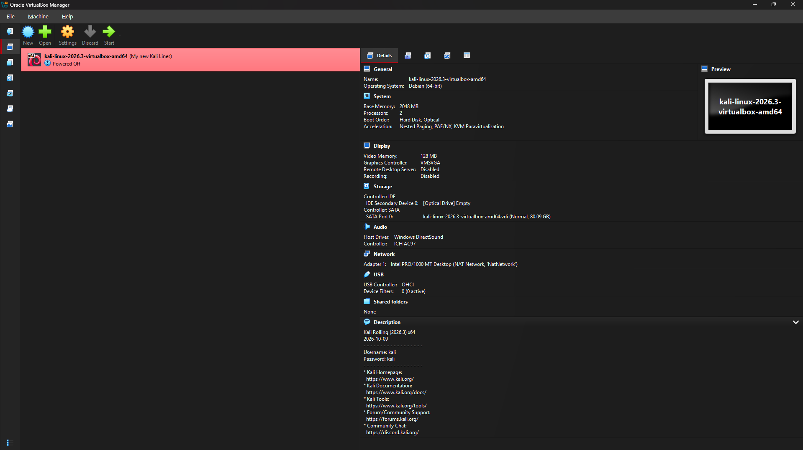
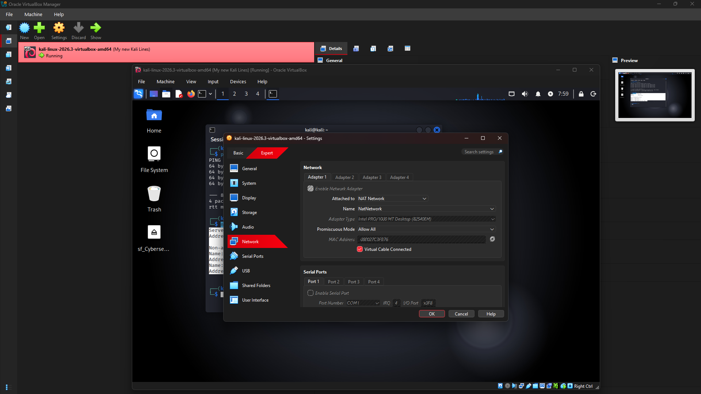
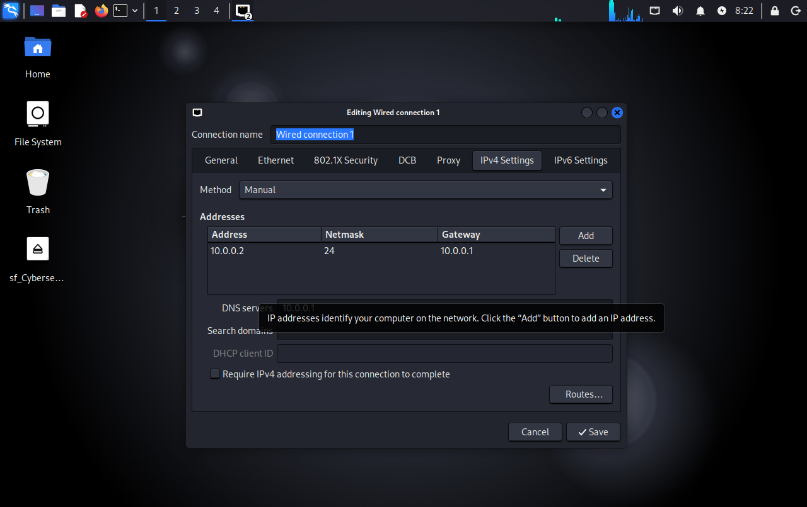

# Cybersecurity Virtual Lab Environment

**Building a controlled virtual environment for cybersecurity learning, network analysis, vulnerability assessment, and authorized penetration testing.**


---

## 1. Project Overview

This project focuses on setting up a virtual cybersecurity laboratory using Oracle VirtualBox and Kali Linux on a Windows 11 host system.

The objective is to establish a controlled environment for learning cybersecurity concepts, understanding network communication, analyzing network traffic, and practising authorized security testing.

The lab uses VirtualBox NAT Network configuration to provide virtual network connectivity for cybersecurity experiments.

## 2. Objectives

- Set up a virtual cybersecurity testing environment.
- Configure Kali Linux as a guest operating system.
- Understand virtual networking using NAT Network mode.
- Configure and verify network interfaces and routing.
- Monitor and analyze network traffic using Wireshark.
- Practise network reconnaissance using Nmap.
- Perform authorized security testing in a controlled environment.

## 3. Lab Environment

| Component | Configuration |
|---|---|
| Host Operating System | Windows 11 |
| Virtualization Platform | Oracle VirtualBox |
| Guest Operating System | Kali GNU/Linux Rolling |
| Kali Version | 2026.3 |
| Virtual Machine Name | kali-linux-2026.3-virtualbox-amd64 |
| Allocated RAM | 2048 MB |
| Virtual Processors | 2 |
| Video Memory | 128 MB |
| Graphics Controller | VMSVGA |
| Network Mode | NAT Network |
| Network Name | NatNetwork |
| Network Interface | eth0 |

## 4. Tools and Technologies

| Tool | Purpose |
|---|---|
| Oracle VirtualBox | Virtual machine creation and management |
| Kali Linux | Cybersecurity testing environment |
| Wireshark | Network packet capture and analysis |
| Nmap | Network discovery and authorized security assessment |

## 5. VirtualBox Setup

Kali Linux was installed as a guest operating system inside Oracle VirtualBox running on Windows 11.

The virtual machine was configured with 2 GB of RAM and 2 virtual processors.

### VirtualBox Manager



### Virtual Machine System Configuration



### Virtual Machine Overview



## 6. Network Configuration

The Kali Linux virtual machine uses a NAT Network adapter named `NatNetwork`.

### VirtualBox Network Settings

- Adapter: Adapter 1
- Network Mode: NAT Network
- Network Name: NatNetwork
- Adapter Type: Intel PRO/1000 MT Desktop
- Virtual Cable: Connected



### Kali Linux IPv4 Configuration

The guest network interface was configured with the following static IPv4 settings:

| Parameter | Value |
|---|---|
| Interface | eth0 |
| IPv4 Address | 10.0.0.2 |
| Subnet Mask | 255.255.255.0 |
| Default Gateway | 10.0.0.1 |
| DNS Server | 10.0.0.1 |



## 7. Network Configuration Verification

The following commands were used to inspect the network configuration.

### Check Network Interfaces

```bash
ip addr
```

Result: The `eth0` interface was active with IPv4 address `10.0.0.2/24`.

### Check Routing Table

```bash
ip route
```

Observed routing information:

```text
default via 10.0.0.1 dev eth0
10.0.0.0/24 dev eth0
```

## 8. Network Connectivity Testing

### Internet Connectivity

Command:

```bash
ping -c 4 8.8.8.8
```

**Test Results:**

| Parameter | Result |
|---|---|
| Packets Transmitted | 4 |
| Packets Received | 4 |
| Packet Loss | 0% |
| Minimum Latency | 6.363 ms |
| Average Latency | 7.066 ms |
| Maximum Latency | 7.606 ms |

Result: Successful connectivity to the external IP address.

### DNS Resolution

Command:

```bash
nslookup google.com
```

**Test Results:**

- DNS Server: `10.0.0.1`
- Resolved IPv4 Address: `142.250.70.46`
- Result: Successful DNS resolution.

## 9. Network Traffic Analysis

Wireshark is included in the lab environment for capturing and analyzing network packets.

The analysis focuses on:

- Inspecting network packets.
- Understanding TCP, UDP, DNS and ICMP traffic.
- Observing communication between network devices.
- Understanding basic network traffic behaviour.

A practical packet-capture demonstration will be added as further testing evidence.

## 10. Troubleshooting and Verification

The following checks were performed during lab configuration:

| Check | Result |
|---|---|
| Kali Linux VM startup | Successful |
| Network interface status | UP |
| IP address assignment | Successful |
| Default gateway configuration | Verified |
| External IP connectivity | Successful |
| DNS resolution | Successful |

### 10.1 Drag and Drop Issue – Shared Folder Solution

**Problem:**

During the lab setup, drag-and-drop functionality between the Windows 11 host and Kali Linux guest operating system was not working as expected. This created difficulties when transferring files between the two environments.

**Solution:**

Instead of relying on drag-and-drop functionality, VirtualBox Shared Folders were configured to enable file exchange between the host and guest operating systems.

**Configuration Steps:**

1. Created a shared folder on the Windows 11 host.
2. Opened VirtualBox VM Settings → Shared Folders.
3. Added the host folder to the virtual machine configuration.
4. Enabled Auto-mount and Full Access.
5. Accessed the shared folder from Kali Linux.

**Shared Folder Configuration:**

| Parameter | Configuration |
|---|---|
| Host OS | Windows 11 |
| Guest OS | Kali Linux |
| Shared Folder | Cybersecurity-Lab-Shared |
| Auto-mount | Enabled |
| Access | Full Access |

**Accessing the Shared Folder:**

The automatically mounted shared folder can be accessed using:

```bash
cd /media/sf_Cybersecurity-Lab-Shared
```

If permission is denied, add the current Kali Linux user to the VirtualBox shared-folder group:

```bash
sudo usermod -aG vboxsf $USER
```

Log out and log back in for the group membership change to take effect.

**Outcome:**

VirtualBox Shared Folders provided an alternative method for transferring files between the Windows host and Kali Linux guest without depending on drag-and-drop functionality.

## 11. Project Structure

```text
Cybersecurity-Virtual-Lab/
│
├── README.md
│
├── screenshots/
│   ├── 01-virtualbox-manager.png
│   ├── 02-virtual-machine-system-settings.png
│   ├── 03-virtual-network-settings.png
│   ├── 04-virtualbox-vm-overview.png
│   └── 05-kali-network-configuration.png
│
└── documentation/
    └── lab-configuration.md
```

## 12. Learning Outcomes

- Understanding virtualization and virtual lab environments.
- Configuring Kali Linux inside Oracle VirtualBox.
- Understanding NAT Network configuration.
- Working with static IPv4 addressing and routing.
- Performing network connectivity and DNS verification.
- Developing practical network traffic analysis skills.
- Troubleshooting file-sharing issues between host and guest systems.
- Gaining exposure to cybersecurity assessment tools.

## 13. Future Improvements

- Perform authorized Nmap network discovery exercises.
- Document practical Wireshark packet analysis.
- Introduce additional virtual machines for controlled security testing.
- Perform basic vulnerability assessment within the lab.
- Create and document VirtualBox snapshots for recovery.
- Expand troubleshooting documentation with practical scenarios.

## 14. Disclaimer

This project is intended strictly for educational purposes and authorized security testing.

All scanning, vulnerability assessment, and penetration testing activities must be performed only on systems owned by the user or for which explicit permission has been obtained.

---

**Author:** Akash P

**Domain:** Cybersecurity

**Project:** Cybersecurity Virtual Lab Environment
